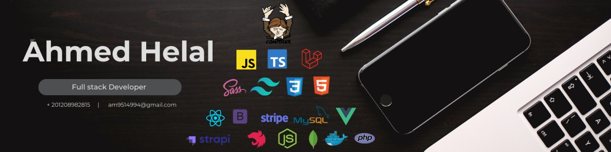

<h1 align="center">
    
</h1>

💻 Full Stack Developer | Laravel, Next.js, React & Vue.js | 7+ years of experience

I build web applications end to end: PHP and Laravel on the backend, and React, Next.js, TypeScript and Vue.js on the frontend.
I enjoy clean code, fast APIs and smooth user experiences.

📍 Cairo, Egypt

---

### 🏢 Currently

**Full Stack Developer at Ventureware** (since Aug 2026), working on the Dulani platform:

- [Dulani Business Center portal](https://dulani.sa/)
- [Event Consultation](https://eventconsultation.dulani.sa/)
- [Business Noura](https://businessnoura.dulani.sa/)
- [Franchise Program](https://franchise.dulani.sa/)

PHP backend APIs, TypeScript web apps, a shared UI library, PHP and Next.js upgrades, and Docker with GitHub Actions CI/CD.

---

### 🚀 Side Projects
- **ERP System** – Full-featured ERP with accounting, HR, and inventory modules.
- **Booking App** – Restaurant and salon booking platform with Laravel + Vue.
- **Affiliate Plugin** – Custom plugin for Botble CMS to manage commissions.

---

### 🧠 Skills & Tools
**Backend:** `PHP` · `Laravel` · `REST APIs` · `JWT` · `Queue Workers` · `PHPUnit`

**Frontend:** `React.js` · `Next.js` · `TypeScript` · `Vue.js` · `JavaScript` · `HTML5` · `CSS3` · `Sass`

**Data & DevOps:** `MySQL` · `Redis` · `Docker` · `Git` · `GitHub Actions` · `CI/CD`

---

### 📊 GitHub Stats

---

### 📫 Let's Connect
- 🌐 [Website](https://ahmedhelal909.github.io/My-Portfolio)
- 💼 [LinkedIn](https://www.linkedin.com/in/ahmed-helal-66718a1ba)
- 📧 **am9514994@gmail.com**

---

⭐️ *Thanks for visiting! Feel free to explore my projects.*
